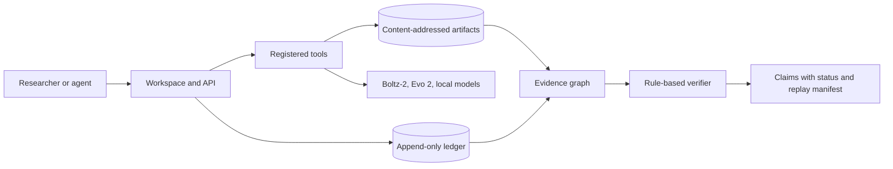

# Concordia

**Concordia is an audit layer for AI-generated biology: it records which model, input and checkpoint produced a structure or sequence claim, tests the claim against independent evidence, and makes the whole analysis replayable.**

[Live workspace](https://srikarjy025-concordia-colony.hf.space) · [Technical overview](docs/technical-overview.md) · [Guide: usage, debugging, security](docs/guide.md) · [For biotech teams](docs/pitch.md)


## Problem

Structure and genome models return confident-looking outputs, and a confidence score is not evidence that a prediction is right. Teams need to know which model and input produced a result, whether it survives perturbation, and whether someone else can replay it. Today that record lives in notebooks.

## Approach

- **Everything is an artifact.** Inputs, outputs and requests are stored by SHA-256, and a one-byte change is refused.
- **Experiments are a graph.** DNA, protein, structure and model-run nodes sit on immutable branches with a deterministic replay manifest.
- **Claims are checked by rules, not another LLM.** A claim needs independent evidence families and a passing counterfactual, or it is reported as `UNVERIFIABLE`.
- **Workflow variants are compared by deterministic fitness.** Variants that never produce a valid response cannot survive selection.



## Results

**Boltz-2 antibody–antigen complexes released after the training cutoff (2023-06-01), scored against the experimental structure.** Selection was a seeded random draw from 94 eligible complexes, and the success rule was fixed before any result: antigen within 5 Å in the antibody frame and at least 50% of crystal contacts recovered. Failures are included.

<!-- BENCH:START -->
| PDB | Released | Model confidence | Antibody RMSD | Antigen alone | Antigen in antibody frame | Crystal contacts recovered | Verdict |
|---|---|---|---|---|---|---|---|
| 8TUZ | 2024-08 | 0.81 | 1.3 Å | 13.5 Å | 18.5 Å | 70% | failure |
| 8VTD | 2025-07 | 0.90 | 1.1 Å | 0.9 Å | 14.1 Å | 3% | failure |
| 8XK6 | 2024-07 | 0.80 | 0.8 Å | 1.5 Å | 33.1 Å | 0% | failure |
| 9LY5 | 2026-03 | 0.78 | 4.2 Å | 1.3 Å | 48.5 Å | 7% | failure |
| 9NPH | 2025-08 | 0.77 | 6.7 Å | 4.0 Å | 22.5 Å | 0% | failure |
| 9NPI | 2025-08 | 0.77 | 5.0 Å | 5.6 Å | 27.1 Å | 2% | failure |
| 9OAO | 2025-06 | 0.84 | 3.2 Å | 1.1 Å | 42.4 Å | 0% | failure |
| 9SSM | 2026-02 | 0.82 | 1.1 Å | 0.9 Å | 26.2 Å | 0% | failure |
| 9VHZ | 2025-10 | 0.86 | 3.8 Å | 1.0 Å | 9.5 Å | 79% | failure |
| 3HFM (reference) | 1989, pre-cutoff | 0.94 | 1.4 Å | 0.8 Å | 2.1 Å | 81% | reference |

**0 of 9 post-cutoff complexes met the success rule.**
<!-- BENCH:END -->

*What this shows.* None of the 9 post-cutoff complexes passed. In 6 of 9 the antigen folds within 1.5 Å on its own, yet it is placed 9.5 to 48.5 Å from the crystal pose, while model confidence stays between 0.77 and 0.90. The closest miss, 9VHZ, recovered 79% of crystal contacts but missed the 5 Å rule at 9.5 Å. In this regime, model confidence is not a proxy for interface correctness, which is the gap an independent check is for. The reference row is a 1989 structure that is likely in the training data, so it shows the pipeline works and not that the model generalizes. Method, selection file and script: [`reports/boltz2-post-cutoff-antibody-benchmark.json`](reports/boltz2-post-cutoff-antibody-benchmark.json), [`scripts/benchmark_antibody_complexes.py`](scripts/benchmark_antibody_complexes.py).

**Software validation.** 243 automated Python tests and 8 browser tests pass in CI. Local throughput is about 3,300 graph operations per second, and exact ledger replay matched on 10 of 10 repetitions. The claim-verifier benchmark scores 50 of 50, but those cases are self-generated, so it checks the plumbing and not real-world accuracy. A local `qwen3:1.7b` seed passed the structured-output qualification protocol, while `phi3:latest` and `gemma3:270m` did not.

## What is implemented

- Durable run API with an append-only ledger, worker leases, idempotent creation, event streaming and replay.
- Experiment graph with branches, comparison, candidate selection and capability-token access.
- Rule-based claim verifier with five statuses and fixture rejection.
- Hosted Boltz-2 complex prediction, OpenFold2 monomer prediction and Evo 2 generation, each recorded with request and response artifacts.
- React workspace with a WebGL provenance graph, a browser-local sequence sandbox and a colony view.

## Reproduce

```bash
make demo     # offline, no network, exits 0
make serve    # interactive workspace at http://127.0.0.1:7860
make test     # pytest, ruff, mypy, frontend build and browser tests
```

## What I would do next

1. Test whether the 3HFM-style pass is memorization by scoring more pre-cutoff and post-cutoff pairs side by side.
2. Make interface-contact recovery a first-class verifier signal.
3. Run a calibration study of model confidence against pose error, with a real alignment in place of the single-sequence stand-in.

## Related work

[Evo 2](https://github.com/ArcInstitute/evo2) · [Boltz-2](https://doi.org/10.1101/2025.06.14.659707) · [SHAP / TreeSHAP](https://github.com/shap/shap) · [CellForge](https://github.com/ArcInstitute/cellforge) · [W3C PROV](https://www.w3.org/TR/prov-overview/)

## Scientific boundaries

Nothing here is a validated biological finding or a therapeutic claim. Fixture outputs are labeled `scientific_use_allowed=false` and cannot receive scientific support status. Structure predictions are computational hypotheses. Evo 2 forward scoring, RFantibody and ProteinMPNN are not integrated yet.

## License

MIT. See [LICENSE](LICENSE) and [CITATION.cff](CITATION.cff).
