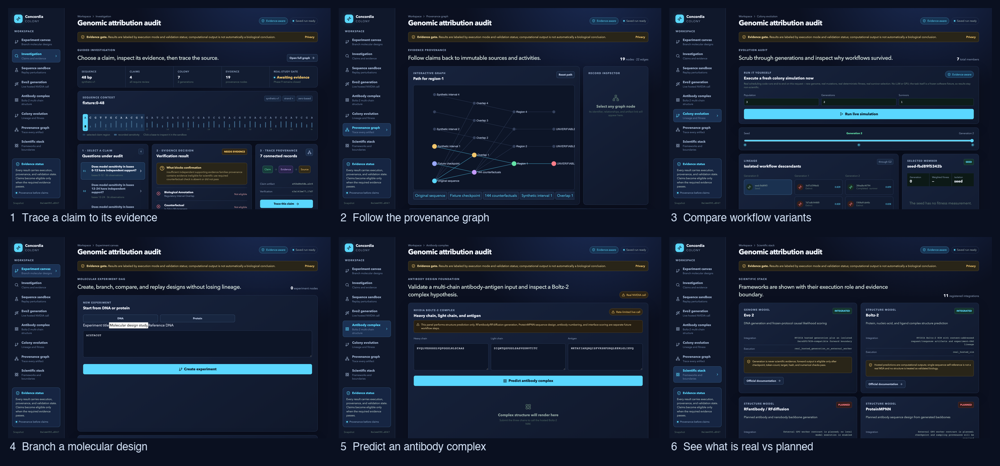
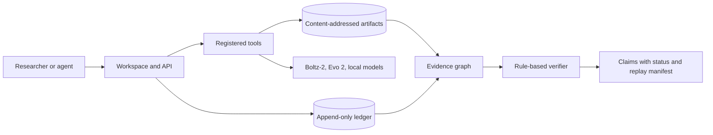

# Concordia

**Concordia is an audit layer for AI-generated biology: it records which model, input and checkpoint produced a structure or sequence claim, tests the claim against independent evidence, and makes the whole analysis replayable.**

[Live workspace](https://srikarjy025-concordia-colony.hf.space) · [Technical overview](docs/technical-overview.md) · [Guide: usage, debugging, security](docs/guide.md) · [For biotech teams](docs/pitch.md)



## Problem

A structure model reports 0.84 confidence on an antibody–antigen complex. The antigen is 42 Å from where the crystal puts it, and none of the crystal's interface contacts are reproduced. That is row 9OAO of the benchmark below, not a hypothetical, and it is not the worst one. A team that trusts that score can spend months of wet-lab work on the wrong candidate. Confidence is not evidence. Teams need to know which model, input and settings produced a result, whether independent evidence supports it, and whether someone else can replay it. Today that record lives in notebooks.

Recording lineage is a solved problem (W3C PROV, MLflow, DVC). What Concordia adds is the check: a claim gets a status from deterministic rules over independent evidence, and the rules say `UNVERIFIABLE` when the evidence is not there.

## Approach

- **Everything is an artifact.** Inputs, outputs and requests are stored by SHA-256, and a one-byte change is refused.
- **Experiments are a graph.** DNA, protein, structure and model-run nodes sit on immutable branches with a deterministic replay manifest.
- **Claims are checked by rules, not another LLM.** A claim needs independent evidence families and a passing counterfactual, or it is reported as `UNVERIFIABLE`.



## Results

### Small benchmark: nine complexes, no baseline model

> **Read this before the table.** Nine complexes are too few to estimate a success rate, and there is no second model to compare against, so this is a demonstration of the method and not a measurement of Boltz-2. The one confound that could be removed has been: the table was produced at reduced settings (20 sampling steps, 1 recycling step, 1 sample), and [a rerun at the hosted NIM defaults](reports/boltz2-antibody-benchmark-nim-defaults.json) — 50 sampling steps, 3 recycling steps, 5 samples — reproduces it, with the same 2 of 9 acceptable or better and the same CAPRI classes. An AlphaFold 3 baseline, submitted by hand, is still missing.

**Boltz-2 antibody–antigen complexes released after the training cutoff (2023-06-01), scored against the experimental structure.** Selection was a seeded random draw from 94 eligible complexes, and the success rule was fixed before any result: antigen within 5 Å in the antibody frame and at least 50% of crystal contacts recovered. Failures are included.

<!-- BENCH:START -->
| PDB | Released | Model confidence | Antibody RMSD | Antigen alone | Antigen in antibody frame | Crystal contacts recovered | DockQ (CAPRI class) | Pre-registered rule |
|---|---|---|---|---|---|---|---|---|
| 8TUZ | 2024-08 | 0.81 | 1.3 Å | 13.5 Å | 18.5 Å | 70% | 0.28 (acceptable) | failure |
| 8VTD | 2025-07 | 0.90 | 1.1 Å | 0.9 Å | 14.1 Å | 3% | 0.11 (incorrect) | failure |
| 8XK6 | 2024-07 | 0.80 | 0.8 Å | 1.5 Å | 33.1 Å | 0% | 0.01 (incorrect) | failure |
| 9LY5 | 2026-03 | 0.78 | 4.2 Å | 1.3 Å | 48.5 Å | 7% | 0.03 (incorrect) | failure |
| 9NPH | 2025-08 | 0.77 | 6.7 Å | 4.0 Å | 22.5 Å | 0% | 0.05 (incorrect) | failure |
| 9NPI | 2025-08 | 0.77 | 5.0 Å | 5.6 Å | 27.1 Å | 2% | 0.04 (incorrect) | failure |
| 9OAO | 2025-06 | 0.84 | 3.2 Å | 1.1 Å | 42.4 Å | 0% | 0.01 (incorrect) | failure |
| 9SSM | 2026-02 | 0.82 | 1.1 Å | 0.9 Å | 26.2 Å | 0% | 0.08 (incorrect) | failure |
| 9VHZ | 2025-10 | 0.86 | 3.8 Å | 1.0 Å | 9.5 Å | 79% | 0.72 (medium) | failure |
| 3HFM (reference) | 1989, pre-cutoff | 0.94 | 1.4 Å | 0.8 Å | 2.1 Å | 81% | 0.81 (high) | reference |

**0 of 9 post-cutoff complexes met the pre-registered rule; 2 of 9 are acceptable or better by DockQ.**
<!-- BENCH:END -->

*What this shows.* By the pre-registered rule none of the 9 passed. By DockQ, the field's standard interface metric, 2 of 9 are correct: 9VHZ is medium quality (0.72) and 8TUZ is acceptable (0.28). The custom rule rejected both because it measures the whole antigen, so a large antigen rotated about a correct interface fails it. The rule is kept because it was fixed in advance; DockQ was added afterwards and is labeled that way in the report. Model confidence does not separate the correct predictions from the wrong ones in this set: the two correct models scored 0.81 and 0.86, while the most confident model (8VTD, 0.90) is incorrect. That gap is what an independent check is for. The reference row is a 1989 structure that is likely in the training data, so it shows the pipeline works and not that the model generalizes. Selection file, method and scripts: [`data/benchmarks/boltz2-post-cutoff-antibody-selection.json`](data/benchmarks/boltz2-post-cutoff-antibody-selection.json), [`reports/boltz2-post-cutoff-antibody-benchmark.json`](reports/boltz2-post-cutoff-antibody-benchmark.json), [`scripts/benchmark_antibody_complexes.py`](scripts/benchmark_antibody_complexes.py), [`scripts/antibody_dockq.py`](scripts/antibody_dockq.py).

**The verifier on the same nine, with the crystal held out.** Each prediction becomes a structure claim. The verifier sees only what is measurable without the experimental structure — interface geometry, agreement across the model's own five samples, and a counterfactual re-prediction with every residue of the predicted paratope mutated to alanine. DockQ is then used as the label, never as evidence.

| | Result |
|---|---|
| Wrong poses supported (false pass) | **0 of 7** |
| Wrong poses contradicted | 1 of 7 (9SSM) |
| Correct poses supported | 0 of 2 — both capped at `PARTIALLY_SUPPORTED` |

**No pose reached `SUPPORTED`, including the correct ones.** That ceiling is the rule pack working as designed, not a bug: `SUPPORTED` requires two independent evidence families, and one model's own output can supply at most one, however many samples it draws. Reaching it needs a second engine, which is the missing AlphaFold 3 baseline. Reported this way the verifier has 0 false passes and 2 false fails.

The one pose it contradicted is the one where the counterfactual failed: for 9SSM, 52% of the interface survived alanine-mutating the entire predicted paratope, so the pose was not using the interface it claimed. Its DockQ is 0.054. That verdict was reached without the crystal.

Two things in this run are worth more than the counts. Self-reported confidence does not separate correct from wrong anywhere in the set — the range is 0.78 to 0.90, and the two correct poses sit inside it, at 0.82 and 0.87. Agreement across a model's own samples does: 0.64 and 0.89 for the two correct poses, against 0.00 to 0.17 for all seven wrong ones. On nine complexes that is a hypothesis worth testing at scale, not a result, and the rule pack deliberately treats same-model agreement as too weak to carry a claim by itself.

An honest oddity: 9OAO's paratope-ablated control scored DockQ 0.753 against the crystal while the unmutated prediction scored 0.014. Mutating the binding site produced a better pose than the real sequence, which is a caveat on trusting any single prediction from this model.

Report: [`reports/verifier-on-boltz-benchmark.json`](reports/verifier-on-boltz-benchmark.json); rules: [`src/concordia/verification/structure_rules.py`](src/concordia/verification/structure_rules.py); callable over HTTP at `POST /v1/structure-claims/verify`, which spends nothing and stores nothing.

**Software validation.** The Python and browser test suites run in CI (`make test`). Local throughput is about 3,300 graph operations per second, and exact ledger replay matched on 10 of 10 repetitions. The claim-verifier benchmark scores 50 of 50, but those cases are self-generated, so it checks the plumbing and not real-world accuracy. A local `qwen3:1.7b` seed passed the structured-output qualification protocol, while `phi3:latest` and `gemma3:270m` did not.

## What is implemented

- Durable run API with an append-only ledger, worker leases, idempotent creation, event streaming and replay.
- Experiment graph with branches, comparison, candidate selection and capability-token access.
- Rule-based claim verifier with five statuses and fixture rejection.
- Hosted Boltz-2 complex prediction, OpenFold2 monomer prediction and Evo 2 generation, each recorded with request and response artifacts.
- React workspace with a WebGL provenance graph, a browser-local sequence sandbox and a colony view.
- De novo binder design through hosted RFdiffusion and ProteinMPNN, re-folded with Boltz-2 and checked by the structure verifier, which has no reference structure to fall back on ([`scripts/design_binder.py`](scripts/design_binder.py)).

### Experimental modules

These packages are research side paths. They are tested, but they are not part of the audit, verify and replay core, and nothing in the results above depends on them: `colonies/` (workflow variants selected by deterministic fitness), `scientist/` (local LLM scientist and its qualification protocol), `virtual_cell/`, `predictors/`, `explanations/` and `interventions/` (the earlier Tox21 Random Forest and TreeSHAP pipeline).

## Reproduce

```bash
make demo     # offline, no network, exits 0
make serve    # interactive workspace at http://127.0.0.1:7860
make test     # pytest, ruff, mypy, frontend build and browser tests
```

## What I would do next

1. Add an AlphaFold 3 baseline by hand through AlphaFold Server, about 20 jobs a day. It is the one piece of evidence that would let a correct pose reach `SUPPORTED`, so without it the false-fail rate above is a ceiling imposed by the setup rather than by the rules.
2. Grow the set to 30-50 complexes from SAbDab under the same seeded selection rule, written down before running. Nine is enough to show the method and not enough to measure anything.
3. Test the one signal that tracked correctness here — agreement across a model's own samples — on that larger set, where it can be checked rather than noticed.
4. Persist the hash-chained ledger on the hosted workspace. The chain and `concordia ledger verify` exist; on a Space the counters and events still live in a filesystem that is wiped on restart unless `CONCORDIA_DATABASE_URL` is set, which `/api/tools` now reports.

## Related work

[Evo 2](https://github.com/ArcInstitute/evo2) · [Boltz-2](https://doi.org/10.1101/2025.06.14.659707) · [SHAP / TreeSHAP](https://github.com/shap/shap) · [CellForge](https://github.com/ArcInstitute/cellforge) · [W3C PROV](https://www.w3.org/TR/prov-overview/)

## Scientific boundaries

Nothing here is a validated biological finding or a therapeutic claim. Fixture outputs are labeled `scientific_use_allowed=false` and cannot receive scientific support status. Structure predictions are computational hypotheses. RFdiffusion and ProteinMPNN are integrated as hosted calls, but no designed binder here has been expressed or assayed, and a design that passes every reference-free check is still only a hypothesis. RFantibody is not integrated.

## License

MIT. See [LICENSE](LICENSE) and [CITATION.cff](CITATION.cff).
